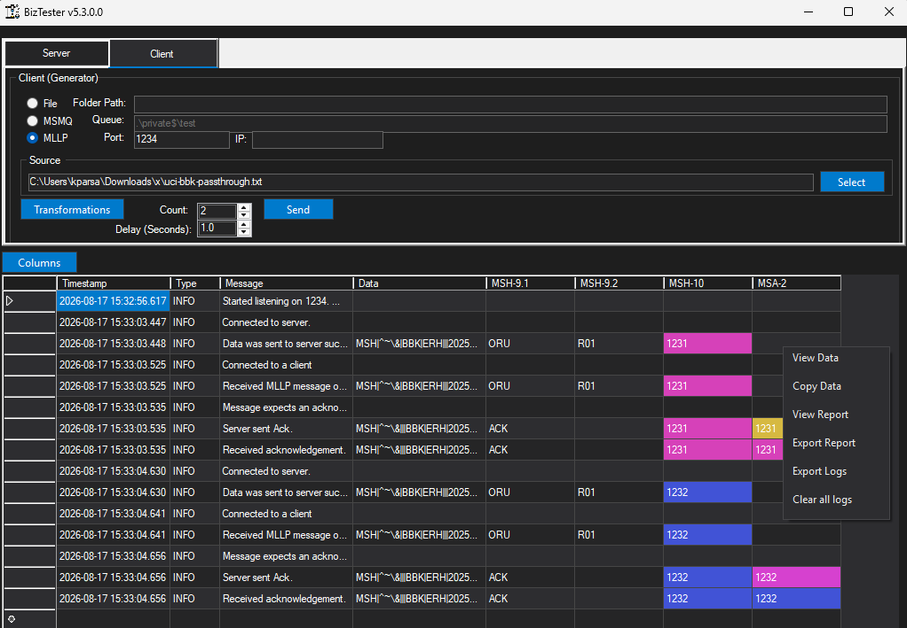

# Introduction

To see the older v5 documentation, <a href="REAME-v5.md">click here</a>.

`BizTester` is a Windows GUI app for sending and receiving HL7v2 messages via MLLP, MSMQ and file protocoles. It can also perform transformations.

# Installation

To install, you can download the installer from the `Installer` folder of this repository.

# Usage
This tool allows you to send or receive HL7 (v2 or v3) with responses from a given file or automatically generate a message to send. 
As shown below, you have the server (listener) settings on the left side and the client (sender) settings on the right side.

As you can see the following protocols are supported:
- File
- MLLP
- MSMQ

The MLLP server has the ability to send back acknowledgement message if the message received indicates that it requires a response (if MSH.15 = 'AL').

`BizTester` also allows you to perform transformation meaning that you can overwrite field values. To do so, on the client tab click on the `Transformations` button.

There are a number of dynamic values you can use that are listed below:
| Value    | Description |
| --------- | ------- |
| {now}     | Inserts the current date/time         |
| {random_num}          | Generates a random 6 digit number        |
| {random_first_name}          | Generates a random first name        |
| {random_last_name}          | Generates a random last name        |
| {count}          | Useful to sending an integer counter that increments as you send messages        |

# Reports

You can view/export a report where message id of sent and received messages are used to combine them. To do so, right click on the result table and select view report/export report.

You can also export the raw data but right clicking and selecting `E`xport Logs`.

# Development
Please feel free to send feature requests, ask questions or report issues on Github.
If you want to pull the code and modify it, note that this project uses .NET 4.6.1 SDK.
