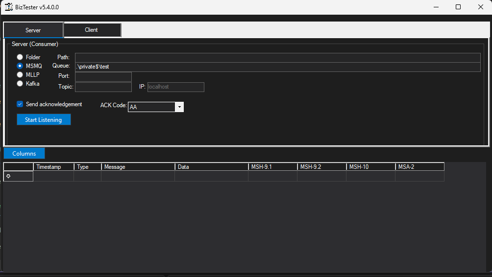
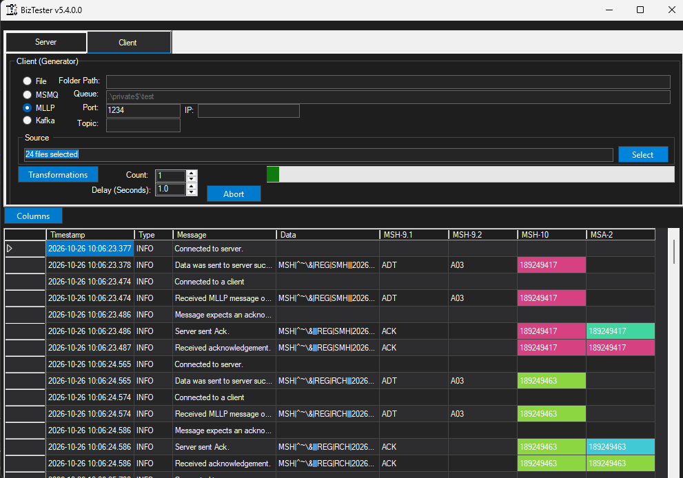
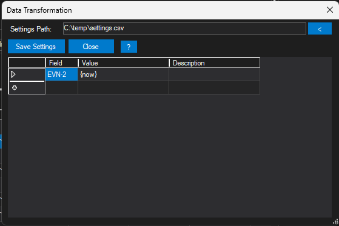
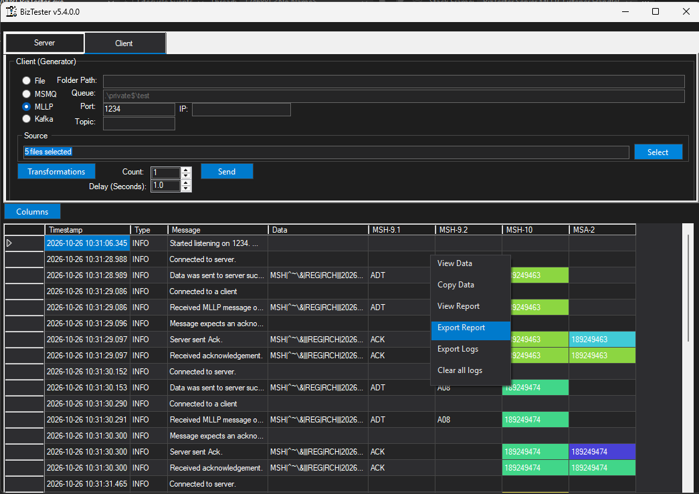
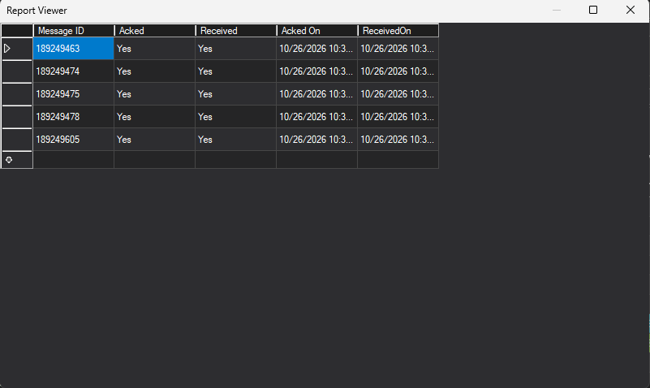
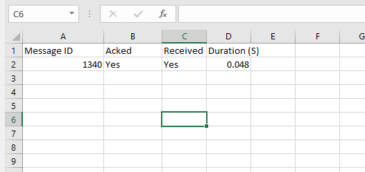

# Introduction

To see the older v5 documentation, <a href="README-v5.md">click here</a>.

`BizTester` is a Windows GUI app for sending and receiving HL7v2 messages via MLLP, MSMQ, file system or Kafka. It can also perform transformations.

# Installation

To install, you can download the installer from the `Installer` folder of this repository.

# Usage
This tool allows you to send or receive HL7 (v2 or v3) with responses from a given file or automatically generate a message to send. 
As shown below, you have the server (listener) settings on the left side and the client (sender) settings on the right side.

As you can see the following protocols are supported:
- File
- MLLP
- MSMQ
- Kafka

The MLLP server has the ability to send back acknowledgement message if the message received indicates that it requires a response (if MSH.15 = 'AL').

`BizTester` also allows you to overwrite field values.
By clicking the "Data Overwrites" button, you can either specify static values or even dynamic values:

There are a number of dynamic values you can use that are listed below:
| Value    | Description |
| --------- | ------- |
| {now}     | Inserts the current date/time         |
| {random_num}          | Generates a random 6 digit number        |
| {random_first_name}          | Generates a random first name        |
| {random_last_name}          | Generates a random last name        |
| {count}          | Generates a positive integer count which increments as you send messages       |

Note that you can send a field and append values to it. For example if in your original message you have PV1-2 = "ABC", and if you apply the transformation `{PV1-2}-X`, it will transform the value to "ABC-X" prior to sending it.

# Export / Report

You can export the results by right clicking on the result data grid as shown below and clicking the `Export Logs`:

However, if you want to see a report based on the message IDs for the send/received messages in the logs, you can either click `View Report` or `Export Report`:

# Development
Please feel free to send feature requests, ask questions or report issues on Github.
If you want to pull the code and modify it, note that this project uses .NET 4.6.1 SDK.
